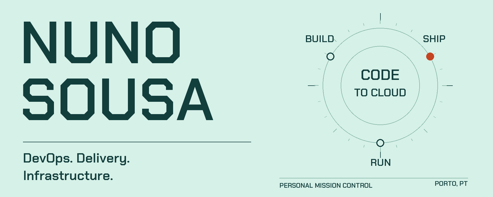

  <a href="https://nunosousa.dev"><strong>Visit my website ↗</strong></a>
  &nbsp; / &nbsp;
  <a href="https://www.linkedin.com/in/nunosowza">Connect on LinkedIn ↗</a>
  &nbsp; / &nbsp;
  <a href="https://github.com/nunosousa-dev?tab=repositories">Explore repositories ↗</a>

I'm **Nuno Sousa**, a **DevOps Engineer** at **Critical TechWorks**, based in **Porto, Portugal**. My focus is processes, tooling, automation, and software delivery—from a workflow in GitHub Actions to the infrastructure behind it.

## Command centre

Select a command to open its panel. No terminal required.

<strong><code>whoami</code> — the person behind the commits</strong>

### Hello from Porto

DevOps is the thread connecting my professional work and my curiosity outside it. Here on GitHub, that extends to web applications, GitOps, and a self-hosted Kubernetes homelab.

I speak **Portuguese** natively and use **English** professionally.

[More about my professional background on LinkedIn ↗](https://www.linkedin.com/in/nunosowza/)

<strong><code>cat stack</code> — applications, delivery, infrastructure</strong>

### From interface to infrastructure

| Layer | Tools in my personal projects |
| :--- | :--- |
| **Application** | TypeScript · Next.js · Node.js |
| **Data** | SQLite · Drizzle |
| **Delivery** | GitHub Actions · Docker · Helm · Argo CD |
| **Infrastructure** | Kubernetes · Terraform · Talos Linux · Proxmox |
| **Networking & monitoring** | Cilium · Prometheus |

<strong><code>verify credentials</code> — learning along the way</strong>

### Automation, infrastructure, and teamwork

| Credential | Issued | Validity listed on LinkedIn |
| :--- | :--- | :--- |
| [GitHub Actions](https://www.credly.com/badges/bd2359ca-d385-43d9-992e-874859a33615) | Jul 2024 | Expires Jul 2027 |
| [Professional Scrum Master I](https://www.credly.com/badges/ba5edd32-8f9a-4286-9891-52e1e3d8488d) | Dec 2022 | No expiry listed |
| [Terraform Associate (002)](https://www.credly.com/badges/05dcf600-c4c9-4645-9dc7-1c93bcf563b9) | Mar 2023 | Expired Mar 2025; historical credential |

Earlier certifications include **Adobe Commerce Cloud Developer** (issued 2021; expired 2023) and **SAP HANA 1.0 Support Associate** (issued 2014).

Credential dates reflect the public LinkedIn profile reviewed in October 2026. Follow the credential links for current verification.

<strong><code>ssh porto</code> — open a conversation</strong>

### Let's connect

Web apps, self-hosting, Kubernetes—or the space between them.

- **Professional:** [LinkedIn](https://www.linkedin.com/in/nunosowza)
- **Personal website:** [nunosousa.dev](https://nunosousa.dev)
- **Code:** [Public repositories](https://github.com/nunosousa-dev?tab=repositories)

The command is a playful label, not a real SSH endpoint.

## Public telemetry

A daily snapshot of public GitHub data—not a live status monitor. Private work stays private.

<!-- PROFILE:START -->
**17 public repositories** · Snapshot: **2026-10-29 15:24 UTC**

| Date (UTC) | Recent public signal |
| :--- | :--- |
| 2026-10-29 | Updated a pull request in [nunosousa-dev/bivomafalda.pt](https://github.com/nunosousa-dev/bivomafalda.pt) |
| 2026-10-27 | Pushed code to [nunosousa-dev/secret-santa](https://github.com/nunosousa-dev/secret-santa) |
| 2026-10-19 | Pushed code to [nunosousa-dev/homelab](https://github.com/nunosousa-dev/homelab) |

[View public activity ↗](https://github.com/nunosousa-dev?tab=overview)
· [Refresh workflow](https://github.com/nunosousa-dev/nunosousa-dev/actions/workflows/profile.yml)

Up to three recent signals from GitHub's public events feed; not a complete contribution history. Updates may be delayed.
<!-- PROFILE:END -->

Built from Markdown, custom artwork, and a little automation. Expand the panels. Follow a link. Look around.
